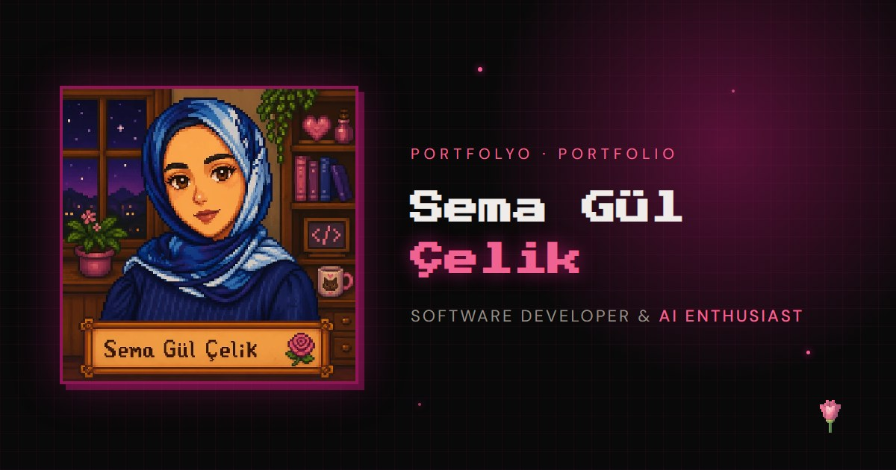
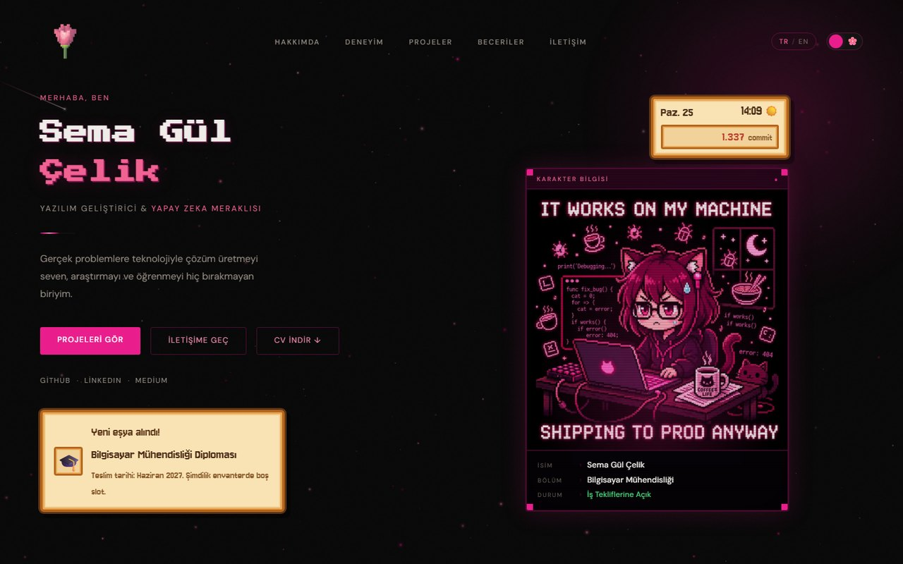
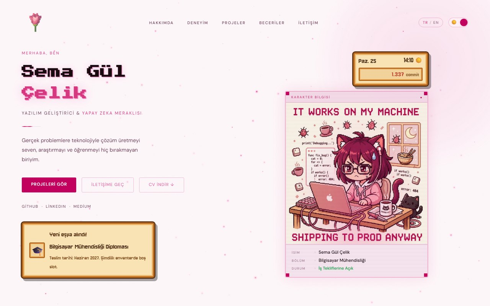
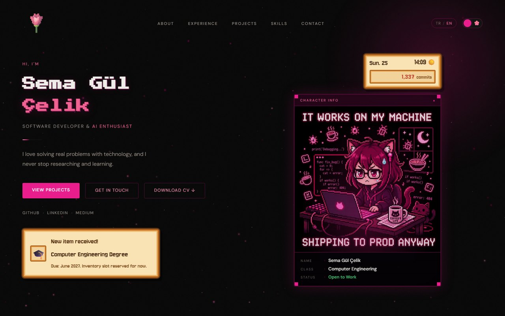
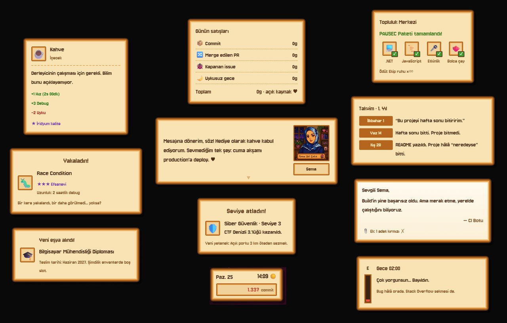
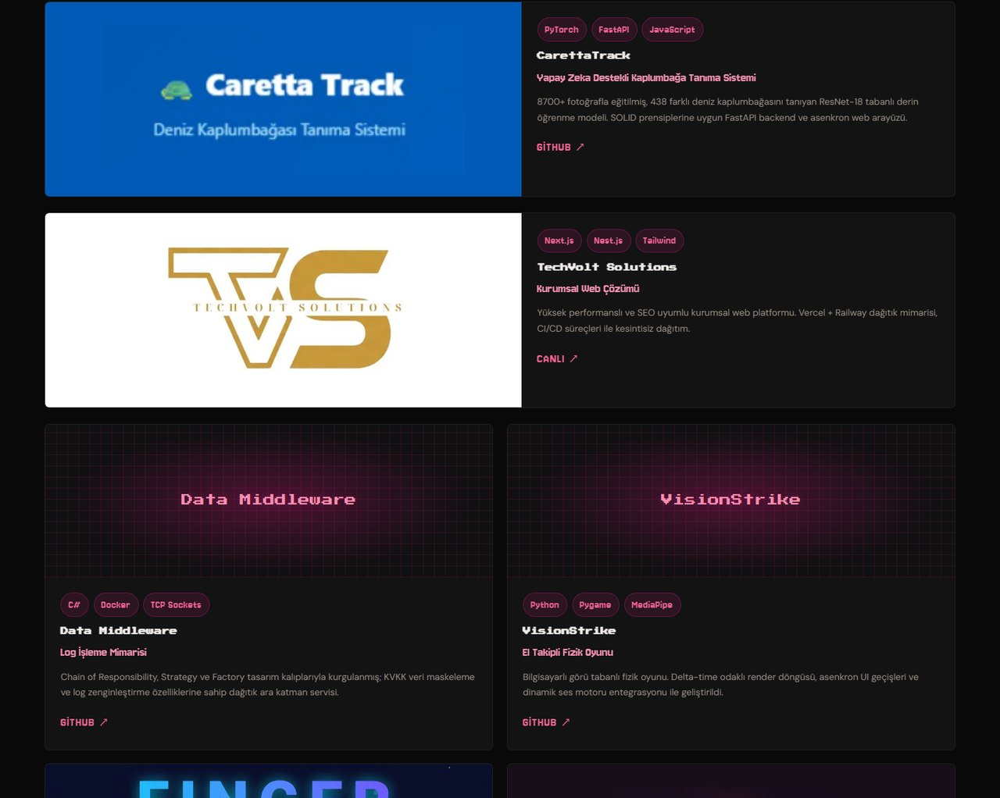
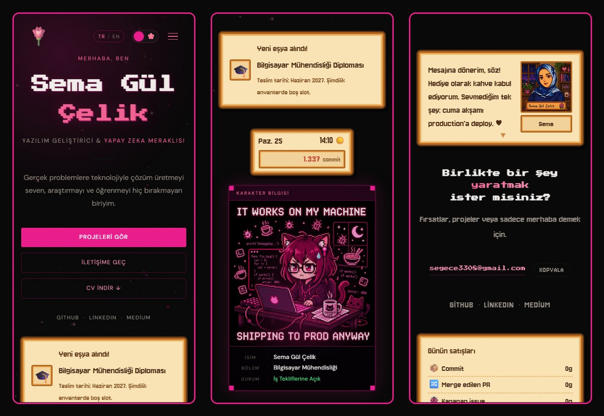

<div align="center">



# 🌸 Sema Gül Çelik · Portfolyo

**Yazılım Geliştirici & Yapay Zeka Meraklısı** — Pamukkale Üniversitesi, Bilgisayar Mühendisliği

[](https://semagulcelik.is-a.dev)


*Gece yarısı debug'lanan, kahveyle derlenen, Stardew Valley sevgisiyle süslenen bir portfolyo.* ☕🌾

[English summary ↓](#-english)

</div>

---

## 📸 Ekran Görüntüleri



<table>
  <tr>
    <td width="50%"></td>
    <td width="50%"></td>
  </tr>
  <tr>
    <td align="center"><sub>🌞 Açık tema</sub></td>
    <td align="center"><sub>🇬🇧 TR / EN dil düğmesi</sub></td>
  </tr>
</table>

### 🌾 Stardew Valley tarzı meme kutuları

Sayfanın her bölümüne yerleştirilmiş, ahşap çerçeveli küçük sürprizler: gerçek saati gösteren HUD, "Yeni eşya alındı!" bildirimi, Topluluk Merkezi paketi, seviye atlama ekranı, eşya açıklaması, balık tutma, gece 02:00 enerji barı, takvim, CI botundan mektup, gün sonu satış kutusu ve portreli NPC diyaloğu.



### 🗂️ Projeler



### 📱 Mobil



---

## ✨ Özellikler

| | |
|---|---|
| 🎮 **RPG karakter kartı** | Hero'da daktilo efektiyle yazılan "karakter bilgisi" ve temaya göre değişen meme görseli |
| 🌾 **Stardew meme'leri** | 12 farklı kutu türü; hero'da gerçek saati gösteren gün/saat/altın HUD'u ve "Yeni eşya alındı!" bildirimi |
| 🌗 **Koyu / açık tema** | Tercih hatırlanır, sayfa ilk boyanmadan uygulanır (yanıp sönme yok) |
| 🇹🇷 🇬🇧 **İki dil** | Tüm içerik TR ve EN; ilk ziyarette tarayıcı diline göre açılır |
| 🌹 **Gül imleci** | Fareyi takip eden pixel gül ve halka (dokunmatik ekranlarda kapalı) |
| ✨ **Parçacık arka planı** | Parlayan pembe noktalar, kayan yıldızlar ve ara sıra bir kuyrukluyıldız |
| 📄 **CV indirme** | Hero'daki butonla tek tıkla PDF |
| 🔗 **Paylaşım önizlemesi** | LinkedIn / WhatsApp / X için 1200×630 `og:image` |
| 📊 **Vercel Analytics** | Ziyaretçi ve tıklama istatistikleri |

**Performans ve erişilebilirlik**
- Görseller WebP (toplam ~0.4 MB)
- Parçacıklar önceden çizilmiş sprite'larla; sekme gizliyken duruyor
- `prefers-reduced-motion` açıksa animasyonlar yerine sabit kare
- Türkçe karakterleri doğru çizen fontlar (İ, Ş, Ğ)

---

## 🛠️ Teknolojiler

- **React 19** + **Vite 8**
- Saf CSS (CSS değişkenleriyle tema, ek kütüphane yok)
- Canvas 2D (parçacık sistemi)
- **oxlint** (lint)
- **Vercel** (yayın + Analytics) · **is-a.dev** (ücretsiz alan adı)
- Fontlar: [Press Start 2P](https://fonts.google.com/specimen/Press+Start+2P), [Jersey 10](https://fonts.google.com/specimen/Jersey+10), [DM Sans](https://fonts.google.com/specimen/DM+Sans), [Cormorant Garamond](https://fonts.google.com/specimen/Cormorant+Garamond)

---

## 📁 Proje Yapısı

```
portfoy/
├── public/
│   ├── cv.pdf              # İndirilebilir CV
│   ├── og.jpg              # Paylaşım önizleme görseli
│   └── projects/           # Proje kapak görselleri (WebP)
├── src/
│   ├── data.js             # ⭐ TÜM İÇERİK BURADA (TR + EN)
│   ├── i18n.jsx            # Dil bağlamı (useLang)
│   ├── components/
│   │   ├── Hero.jsx        # RPG karakter kartı
│   │   ├── Meme.jsx        # Stardew tarzı meme kutuları
│   │   ├── Works.jsx       # Proje kartları
│   │   └── …
│   ├── hooks/
│   │   ├── useVisuals.js   # Parçacık sistemi + gül imleci
│   │   └── useReveal.js    # Kaydırınca beliren animasyonlar
│   └── index.css
└── docs/screenshots/       # README görselleri
```

---

## ✏️ İçeriği Güncelleme

Neredeyse her şey **`src/data.js`** içinde:

- **Proje eklemek:** `projectBase` dizisine linkleri/etiketleri, `tr.projects` ve `en.projects` içine metinleri ekle. Görseli `public/projects/` altına koy.
  Logo gibi kırpılmaması gereken görseller için `photoFit: "contain"` ve `photoBg: "#renk"` kullan.
- **Deneyim / beceriler:** `experienceBase`, `skillItems` ve dil bloklarındaki karşılıkları.
- **Meme'ler:** `memes` alanı. Türler: `hud`, `toast`, `levelup`, `bundle`, `item`, `catch`, `energy`, `calendar`, `mail`, `shipping`, `npc`, `image`.
  Kendi meme görselini eklemek için dosyayı `public/memes/` altına koy ve şöyle yaz:
  ```js
  works: { kind: "image", src: "/memes/benim-meme.webp", alt: "…", caption: "…" }
  ```
- **CV:** `public/cv.pdf` dosyasını değiştir.

---

## 🚀 Lokal Çalıştırma

```bash
npm install
npm run dev       # http://localhost:5173
npm run build     # dist/ klasörüne üretim çıktısı
npm run lint      # oxlint
```

`main` dalına yapılan her push Vercel'de otomatik yayına alınır; PR'lar için önizleme linki oluşur.

---

## 🙏 Teşekkür

- Arayüzdeki ahşap çerçeveli kutular, ConcernedApe'in **Stardew Valley** oyunundan esinlenmiştir. Oyunla resmi bir bağı yoktur ve oyuna ait hiçbir görsel kullanılmamıştır; tüm kutular CSS ile çizilmiştir.
- Ücretsiz alan adı için [is-a.dev](https://is-a.dev) ekibine teşekkürler.

---

## 🇬🇧 English

Personal portfolio of **Sema Gül Çelik**, a Computer Engineering student at Pamukkale University focused on AI, computer vision and full-stack development.

**Live:** [semagulcelik.is-a.dev](https://semagulcelik.is-a.dev)

- Pixel-art / RPG aesthetic with Stardew Valley–inspired meme boxes: a live day/time/gold HUD, "new item received" toast, Community Center bundle, level-up screen, item tooltip, fishing catch, 2 AM energy bar, calendar, a letter from the CI bot, end-of-day shipping bin and an NPC dialog
- Turkish / English toggle, dark / light theme, custom rose cursor, canvas particle background
- Downloadable CV, Open Graph preview image, Vercel Analytics
- Built with React 19 + Vite 8 and plain CSS; all content lives in `src/data.js`

```bash
npm install && npm run dev
```

<div align="center">
<sub>Kahveyle derlendi ☕ · Made with 🌸 in Denizli</sub>
</div>
