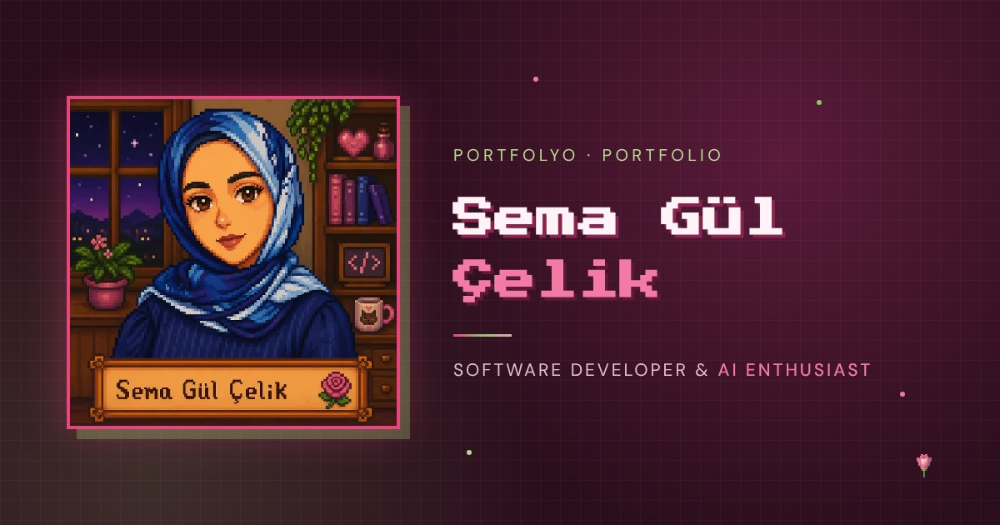
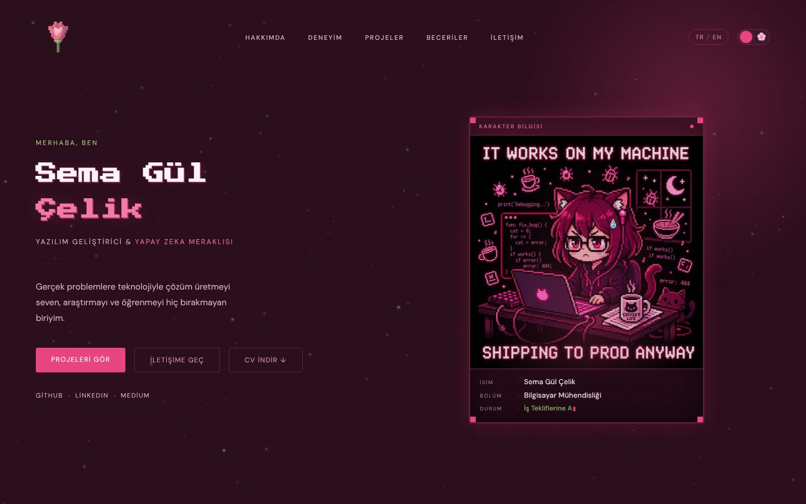
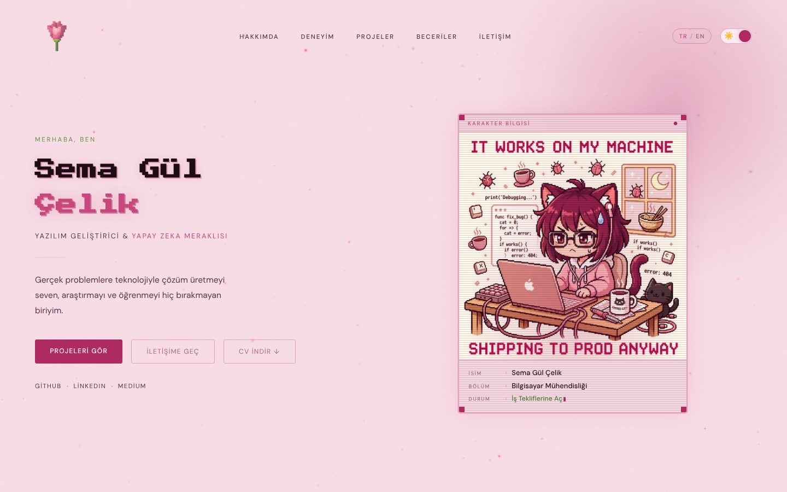
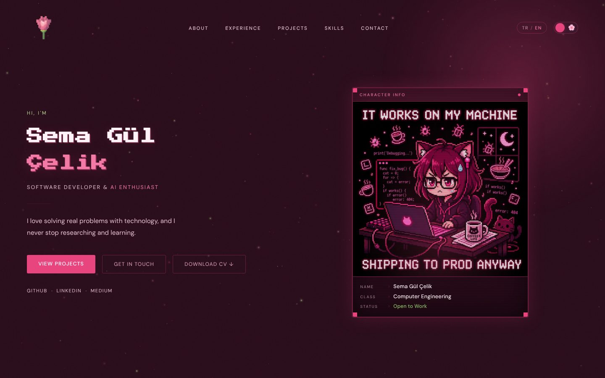
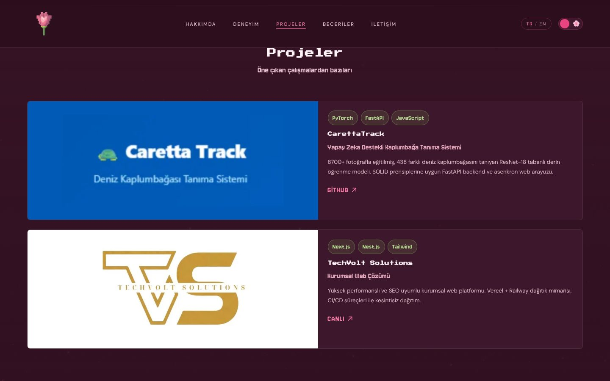
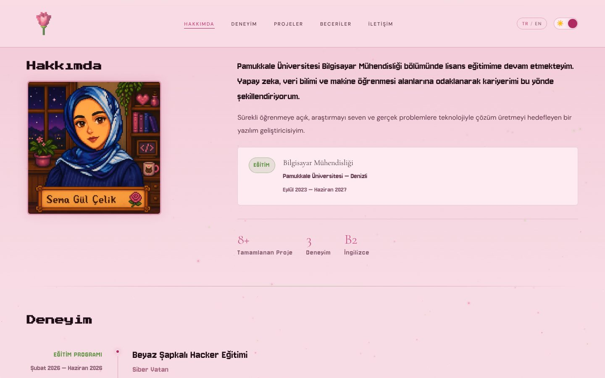
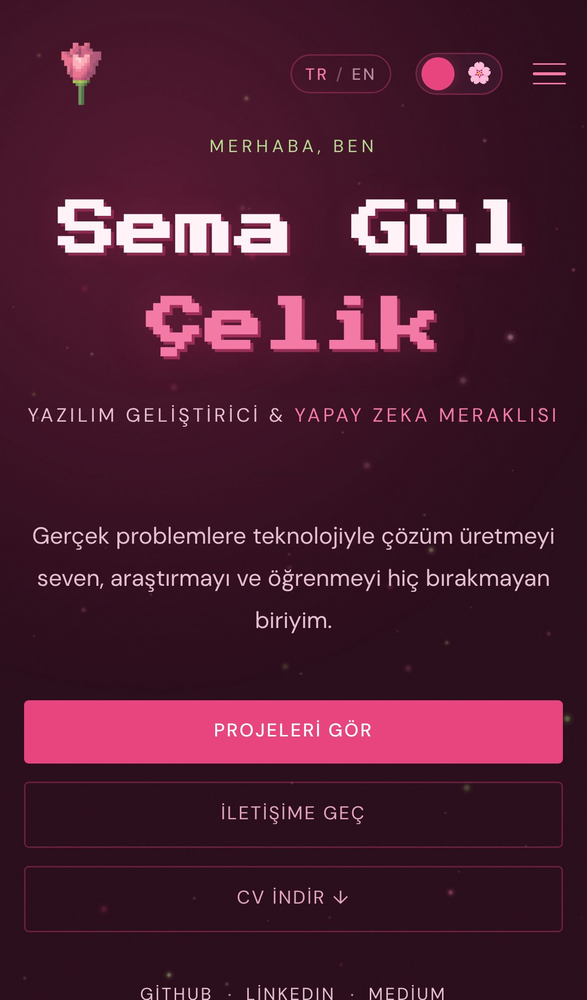
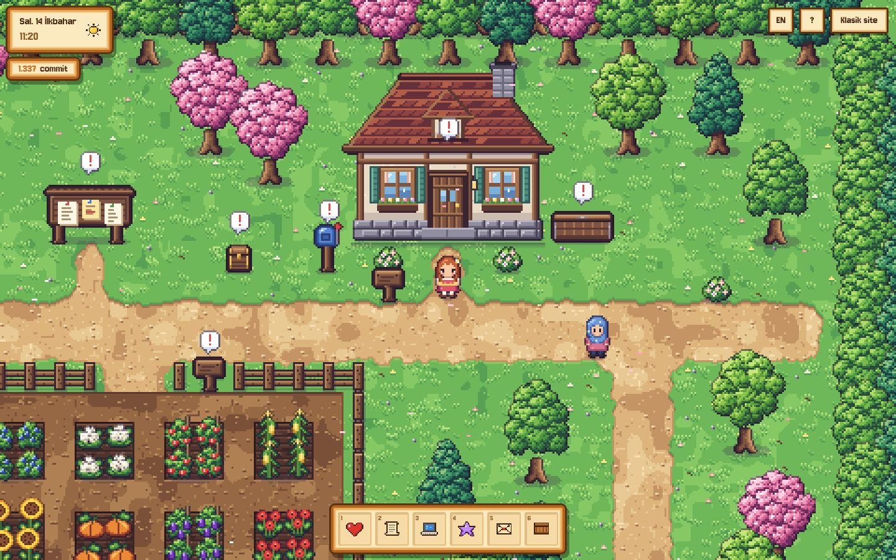
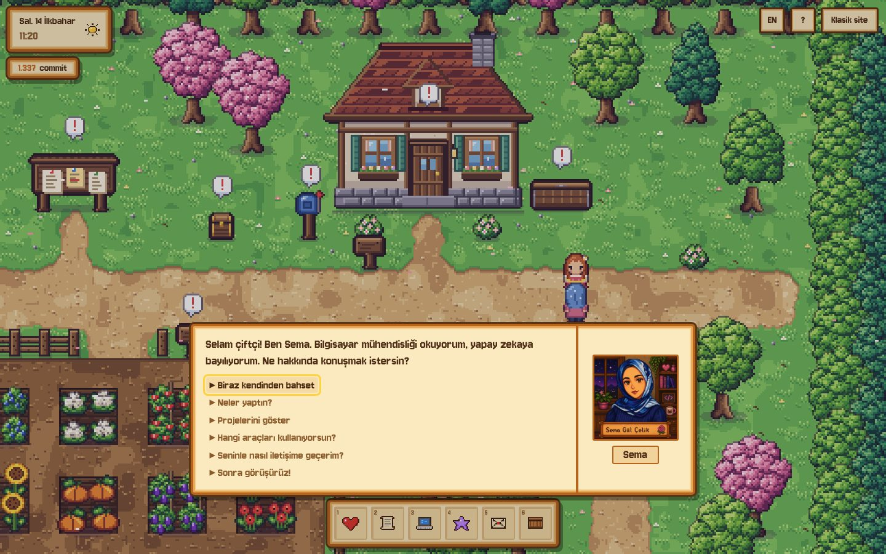
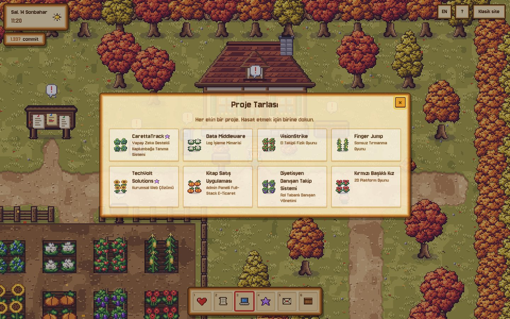

<div align="center">



# 🌸 Sema Gül Çelik · Portfolyo

**Yazılım Geliştirici & Yapay Zeka Meraklısı** — Pamukkale Üniversitesi, Bilgisayar Mühendisliği

[](https://semagulcelik.is-a.dev)


-93c26c?style=flat-square)

*Gece yarısı debug'lanan, kahveyle derlenen, pembe ve yaprak yeşiliyle süslenen bir portfolyo.* ☕🌸

[🎮 v2: oyun sürümü ↓](#-v2--oyun-sürümü-deneme) · [English summary ↓](#-english)

</div>

---

## 📸 Ekran Görüntüleri



<table>
  <tr>
    <td width="50%"></td>
    <td width="50%"></td>
  </tr>
  <tr>
    <td align="center"><sub>🌞 Açık tema (toz pembe)</sub></td>
    <td align="center"><sub>🇬🇧 TR / EN dil düğmesi</sub></td>
  </tr>
</table>

### 🗂️ Projeler ve Hakkımda

<table>
  <tr>
    <td width="50%"></td>
    <td width="50%"></td>
  </tr>
</table>

### 📱 Mobil



---

## ✨ Özellikler

| | |
|---|---|
| 🎮 **RPG karakter kartı** | Hero'da daktilo efektiyle yazılan "karakter bilgisi" ve temaya göre değişen meme görseli |
| 🎨 **Pembe-yeşil palet** | Koyu pembe ve toz pembe ağırlıklı zeminler, yaprak yeşili vurgular; siyah/beyaz yalnızca yazılarda |
| 🌗 **Koyu / açık tema** | Tercih hatırlanır, sayfa ilk boyanmadan uygulanır (yanıp sönme yok) |
| 🇹🇷 🇬🇧 **İki dil** | Tüm içerik TR ve EN; ilk ziyarette tarayıcı diline göre açılır |
| 🌹 **Gül imleci** | Fareyi takip eden pixel gül ve halka (dokunmatik ekranlarda kapalı) |
| ✨ **Parçacık arka planı** | Parlayan pembe ve yeşil noktalar, kayan yıldızlar ve ara sıra bir kuyrukluyıldız |
| 📄 **CV indirme** | Hero'daki butonla tek tıkla PDF |
| 🔗 **Paylaşım önizlemesi** | LinkedIn / WhatsApp / X için 1200×630 `og:image` |
| 📊 **Vercel Analytics** | Ziyaretçi ve tıklama istatistikleri |

**Performans ve erişilebilirlik**
- Görseller WebP (toplam ~0.4 MB)
- Parçacıklar önceden çizilmiş sprite'larla; sekme gizliyken duruyor
- `prefers-reduced-motion` açıksa animasyonlar yerine sabit kare
- Türkçe karakterleri doğru çizen fontlar (İ, Ş, Ğ)

---

## 🎮 v2 · Oyun Sürümü (deneme)

Portfolyonun deneysel ikinci sürümü [`v2`](https://github.com/semagllclkk/portfolyo/tree/v2) dalında: site, Stardew Valley'den esinlenen ve karakterle dolaşılan pixel-art bir çiftliğe dönüşüyor. Bölümleri okumak yerine keşfediyorsun.

**Önizleme:** [semagulcelik-git-v2-sema-guls-projects.vercel.app](https://semagulcelik-git-v2-sema-guls-projects.vercel.app)



<table>
  <tr>
    <td width="50%"></td>
    <td width="50%"></td>
  </tr>
  <tr>
    <td align="center"><sub>💬 Sema ile konuş, bir konu seç</sub></td>
    <td align="center"><sub>🌾 Her ekin bir proje</sub></td>
  </tr>
</table>

- **Her yapı bir bölüm:** çiftlik evi → Hakkımda, görev panosu → Deneyim, tarladaki ekinler → Projeler, sandık → Beceriler, posta kutusu → İletişim, satış kutusu → CV.
- **Kız ya da erkek çiftçi** seçilebiliyor; yoldaki **Sema** ile konuşulabiliyor, iskelede "bug" balığı tutulabiliyor.
- **Gerçek saat ve mevsim:** akşamları harita kararıyor ve pencereler yanıyor; mevsim gerçek aya göre seçiliyor, tarihe tıklayınca değişiyor.
- **Kontroller:** WASD / ok tuşları, E / Boşluk, tıkla-yürü (mobilde dokun), 1–6 hızlı menü.
- Bütün görseller koddan üretiliyor (`src/game/`); oyuna ait hiçbir görsel kullanılmadı.

---

## 🛠️ Teknolojiler

- **React 19** + **Vite 8**
- Saf CSS (CSS değişkenleriyle tema, ek kütüphane yok)
- Canvas 2D (parçacık sistemi)
- **oxlint** (lint)
- **Vercel** (yayın + Analytics) · **is-a.dev** (ücretsiz alan adı)
- Fontlar: [Press Start 2P](https://fonts.google.com/specimen/Press+Start+2P), [Jersey 10](https://fonts.google.com/specimen/Jersey+10), [DM Sans](https://fonts.google.com/specimen/DM+Sans), [Cormorant Garamond](https://fonts.google.com/specimen/Cormorant+Garamond)

---

## 📁 Proje Yapısı

```
portfoy/
├── public/
│   ├── cv.pdf              # İndirilebilir CV
│   ├── og.jpg              # Paylaşım önizleme görseli
│   └── projects/           # Proje kapak görselleri (WebP)
├── src/
│   ├── data.js             # ⭐ TÜM İÇERİK BURADA (TR + EN)
│   ├── i18n.jsx            # Dil bağlamı (useLang)
│   ├── components/
│   │   ├── Hero.jsx        # RPG karakter kartı
│   │   ├── Works.jsx       # Proje kartları
│   │   └── …
│   ├── hooks/
│   │   ├── useVisuals.js   # Parçacık sistemi + gül imleci
│   │   └── useReveal.js    # Kaydırınca beliren animasyonlar
│   └── index.css
└── docs/screenshots/       # README görselleri
```

---

## ✏️ İçeriği Güncelleme

Neredeyse her şey **`src/data.js`** içinde:

- **Proje eklemek:** `projectBase` dizisine linkleri/etiketleri, `tr.projects` ve `en.projects` içine metinleri ekle. Görseli `public/projects/` altına koy.
  Logo gibi kırpılmaması gereken görseller için `photoFit: "contain"` ve `photoBg: "#renk"` kullan.
- **Deneyim / beceriler:** `experienceBase`, `skillItems` ve dil bloklarındaki karşılıkları.
- **Renkler:** `src/index.css` başındaki tokenlar (`--pink`, `--pink-ll`, `--green`, `--bg` …). Koyu ve açık mod ayrı bloklarda.
- **CV:** `public/cv.pdf` dosyasını değiştir.

---

## 🚀 Lokal Çalıştırma

```bash
npm install
npm run dev       # http://localhost:5173
npm run build     # dist/ klasörüne üretim çıktısı
npm run lint      # oxlint
```

`main` dalına yapılan her push Vercel'de otomatik yayına alınır; PR'lar için önizleme linki oluşur.

---

## 🙏 Teşekkür

- v2'deki oyun sürümü ConcernedApe'in **Stardew Valley** oyunundan esinlenmiştir. Oyunla resmi bir bağı yoktur ve oyuna ait hiçbir görsel kullanılmamıştır; bütün sprite'lar koddan üretilmiştir.
- Ücretsiz alan adı için [is-a.dev](https://is-a.dev) ekibine teşekkürler.

---

## 🇬🇧 English

Personal portfolio of **Sema Gül Çelik**, a Computer Engineering student at Pamukkale University focused on AI, computer vision and full-stack development.

**Live:** [semagulcelik.is-a.dev](https://semagulcelik.is-a.dev)

- Pixel-art / RPG aesthetic in a pink and leaf-green palette (deep pink and dusty pink surfaces, green accents)
- Turkish / English toggle, dark / light theme, custom rose cursor, canvas particle background
- Downloadable CV, Open Graph preview image, Vercel Analytics
- Built with React 19 + Vite 8 and plain CSS; all content lives in `src/data.js`
- **v2 (experimental):** a playable Stardew Valley–inspired farm where each building opens a section. See the [`v2`](https://github.com/semagllclkk/portfolyo/tree/v2) branch and its [preview](https://semagulcelik-git-v2-sema-guls-projects.vercel.app).

```bash
npm install && npm run dev
```

<div align="center">
<sub>Kahveyle derlendi ☕ · Made with 🌸 in Denizli</sub>
</div>
